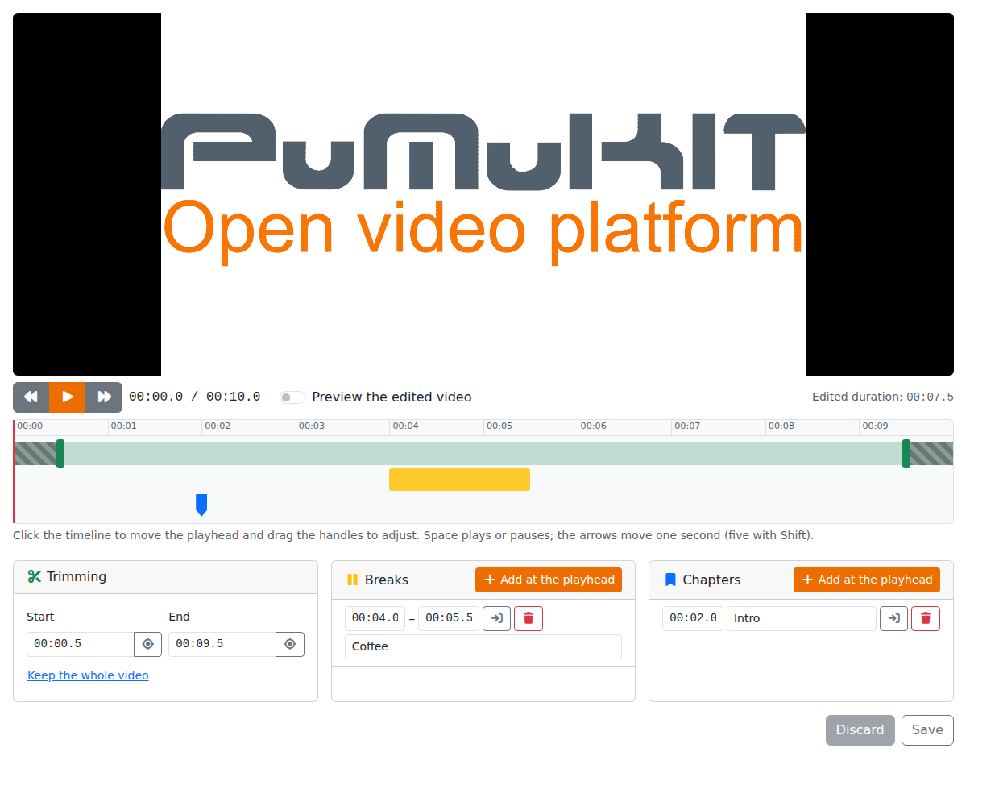

# Soft Video Editor Bundle

Bundle based on [Symfony](http://symfony.com/) to work with the [PuMuKIT Video Platform 6.0](https://github.com/pumukit/PuMuKIT/tree/6.0.x) or higher.

This bundle adds a soft-editing video editor to the "Edit" tab of the multimedia objects in the back-office:
trim the start and the end, add breaks that are skipped when the video is played and add chapter marks.
The original tracks are not modified.



Features
--------

- Timeline with the trimming handles, the breaks and the chapters; drag them or type the times.
- Preview mode that plays the video as the viewers will see it.
- Dual-stream videos show both tracks in sync and keep the "Default layout" selector.
- Keyboard: space plays or pauses, the arrows move one second (five with Shift).

The editor is a Stimulus controller served by the AssetMapper of PuMuKIT: there is nothing to build.

How it is stored
----------------

The edition is stored as the annotations that the player and the portal of PuMuKIT already read:

| Annotation        | Value                                                     | Used by                                   |
|-------------------|-----------------------------------------------------------|-------------------------------------------|
| `paella/trimming` | `{"trimming": {"start": 10, "end": 90}}`                  | Paella player (trimming)                  |
| `paella/breaks`   | `{"breaks": [{"id": 1, "s": 20, "e": 30, "text": "..."}]}` | Paella player (`breaksPlugin`)            |
| `paella/marks`    | `{"marks": [{"id": 1, "s": 45, "name": "..."}]}`           | Portal chapter list (`ChapterMarkService`) |

Times are in seconds. The editor only saves breaks inside the trimming, and no breaks when the start is
trimmed: the breaks plugin of the player does not take the trimming into account (it skips the wrong part and
can freeze the browser), so for now cut the beginning with a break from 0 instead of trimming the start.

After saving, the duration of the multimedia object becomes the edited one and the `soft-editing-duration`
property is set; removing the edition restores the duration of the master track.

Access
------

The editor needs `ROLE_ACCESS_MULTIMEDIA_SERIES` and the right to edit the multimedia object (users with the
personal scope can only edit their own videos).

Installation
------------

```bash
composer require teltek/pumukit-soft-video-editor-bundle
```

If Symfony Flex does not do it, add the bundle to `config/bundles.php`:

```php
Pumukit\SoftVideoEditorBundle\PumukitSoftVideoEditorBundle::class => ['all' => true],
```

and its routes:

```yaml
pumukit_soft_video_editor:
  resource: "@PumukitSoftVideoEditorBundle/Resources/config/routing.yml"
  prefix:   /
```

Then clear the cache:

```bash
php bin/console cache:clear
```
